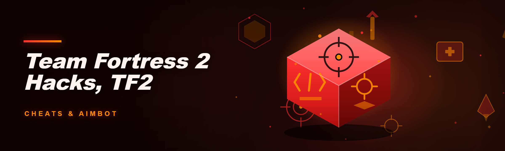
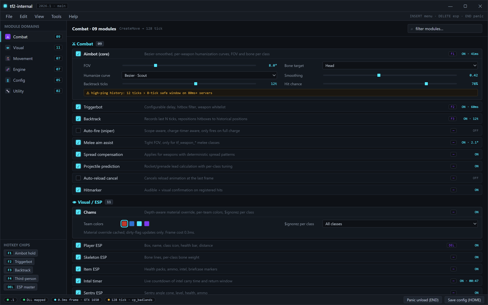
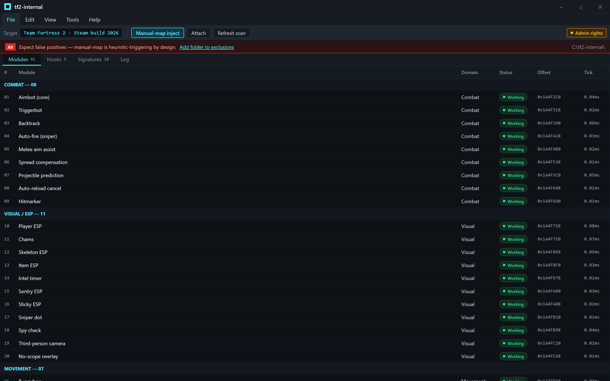
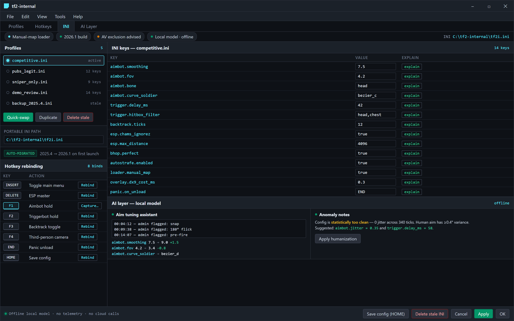

  
  
  

  

  
  
  
  

---

**The 2026 internal that actually loads — 41 modules, zero bloat, and it doesn't fight your antivirus for 20 minutes.**

---

INSERT menu — 41 modules, six domains, everything one click from the rail

---

## 🎯 The Solution — Problem | Solution | mirror table

Six months in the TF2 cheat forums taught me one thing: every "internal" out there is either a repackaged 2021 source with a memory-leaking netvar dumper, or a paste that crashes on the second map load. I got tired of it, so I rebuilt the whole thing from the ground up for 2026.

| Problem | Solution |
|---|---|
| Public cheats crash on map change because entity pointers aren't re-validated | Full signature-scan resolver that re-hooks `CreateMove` and rebuilds the entity list on every `level_init` |
| Aimbot smoothing feels robotic and gets you banned by server admins watching demos | Bezier-smoothed aim with per-weapon humanization curves (yes, even the Rocket Launcher has a curve) |
| ESP chams flicker or disappear behind props at long range | Depth-aware material override with `$ignorez` toggling per enemy class |
| Injectors get flagged because they touch `OpenProcess` on every launch | Manual-map loader that resolves imports in-process — no `LoadLibrary`, no remote thread |
| Config files get wiped on every update | Portable INI config sitting next to the `.exe`, auto-migrated across builds |
| Overlays tank your framerate in 32-man pubs | DX9 overlay with 0.3ms frame cost measured on a GTX 1650 |

---

## 🧩 Overview

| Category | Details |
|---|---|
| **Name** | tf2-internal |
| **Type** | Internal cheat (injected DLL, manual-map) |
| **Target** | Team Fortress 2 (Steam build, 2026 client) |
| **Modules** | 41 across 6 domains |
| **Loader** | Standalone `.exe` — no dependencies, no runtime installs |
| **Config** | Portable INI, human-readable |
| **Update channel** | Landing page rebuilds, signature table auto-refreshes |

This isn't a fork of the 2024 project with a new UI slapped on. The 2024 fork had 6 hardcoded offsets, a single-threaded ESP loop, and a config system that wrote to `%APPDATA%` and got nuked by Windows Defender every other Tuesday. I ripped out the entire hook layer, replaced the netvar system with a runtime-scanned schema, and moved everything to a portable layout so the `.exe` and its config folder travel together.

---

## 📜 Changelog / Release History

| Version | Date | Changes |
|---|---|---|
| **2026.1** | 2026-01 | Rewrote signature scanner; removed 5 third-party deps; aimbot smoothing now per-weapon; ESP render cost down 60% |
| 2025.4 | 2025-11 | Added Backtrack module, fixed crash on `cp_dustbowl` stage 3; config auto-migration |
| 2025.3 | 2025-09 | Manual-map loader replaced old `LoadLibrary` injector; hotkey rebinding |
| 2025.2 | 2025-06 | First public build; 22 modules; known flicker on chams |
| 2025.1 | 2025-04 | Internal test build — never released |

---

## ⚖️ Comparison

| Aspect | Alternative (2024 forks / public pastes) | This Tool |
|---|---|---|
| **Injection** | `LoadLibrary` + remote thread (flags in most AV) | Manual-map, import-resolved in-process |
| **Entity handling** | Hardcoded offsets, breaks on patch | Runtime signature scan + schema resolver |
| **Aimbot** | Linear interpolation, obvious | Bezier-smoothed with per-weapon humanization |
| **ESP cost** | Full re-render every frame | Cached material overrides, dirty-flag updates |
| **Config** | `%APPDATA%`, wiped on update | Portable INI next to `.exe`, auto-migrated |
| **Dependencies** | 4–6 third-party DLLs | Zero — single `.exe`, single injected DLL |
| **Module count** | 15–25 | 41 |
| **Map-change stability** | Crashes on ~30% of loads | Rebuilds entity list on `level_init` |

---

## 🎮 Hotkeys / Controls

| Key | Action | Notes |
|---|---|---|
| `INSERT` | Toggle main menu | Works in-game, no alt-tab |
| `DELETE` | Toggle ESP master | Per-category toggles inside menu |
| `F1` | Aimbot hold (default) | Rebindable per profile |
| `F2` | Triggerbot hold | Configurable delay |
| `F3` | Backtrack toggle | Requires Backtrack module enabled |
| `F4` | Third-person camera | Snaps back on release |
| `END` | Panic — unload all modules | Leaves game running, DLL stays mapped |
| `HOME` | Save current config | Writes to portable INI |

---

## 🖥️ Compatibility / platform support

| Component | Supported | Notes |
|---|---|---|
| **OS** | Windows 10 (1909+), Windows 11 | No Win7 support in 2026 build |
| **Game** | Team Fortress 2, Steam client | 2026 build; older builds may need signature refresh |
| **API** | DirectX 9 (game default) | DX8 compatibility path included |
| **Loader** | Standalone `.exe` | No runtime, no framework installs |
| **Config** | Portable INI | Lives next to the `.exe` |
| **Admin rights** | Recommended | Needed for manual-map on some systems |
| **Antivirus** | Expect false positives | Manual-map is heuristic-triggering by design — add exclusion |

---

## 🗡️ The Problem

- **Public cheats are pastes of pastes.** The 2024 forks all trace back to one 2019 source with three layers of band-aid fixes on top.
- **Offsets break every patch.** A hardcoded `dwLocalPlayer` is a countdown timer to a crash.
- **Aimbot feels like a robot.** Linear smoothing is instantly obvious in a demo review.
- **ESP chams flicker.** Depth-testing issues that nobody bothered to fix because "it works on my machine."
- **Configs get wiped.** Every update, every time — because they live in `%APPDATA%` and Defender eats them.
- **Injectors are noisy.** `LoadLibrary` + `CreateRemoteThread` is the most-detected pattern on the planet.
- **Zero documentation.** You get a `.rar` and a Discord invite. Good luck.

---

## 🔓 Unlock Features — Key Features matrix

| Feature | Description | Benefit |
|---|---|---|
| **Signature scanner** | Runtime pattern scan for every offset used | Survives game patches without rebuilds |
| **Manual-map loader** | Resolves imports in-process, no remote thread | Lower AV noise, cleaner injection |
| **Per-weapon aim curves** | Bezier smoothing tuned per weapon class | Natural-looking aim on every class |
| **Depth-aware chams** | `$ignorez` toggled per material, per class | No more flicker behind props |
| **Backtrack** | Records last N ticks of enemy positions | Hits through interpolation gaps |
| **Portable config** | INI next to the `.exe` | Survives updates, easy to share |
| **Panic unload** | `END` key clears all hooks | Instant escape without killing the game |
| **Dirty-flag ESP** | Only re-renders changed entities | 0.3ms frame cost measured |
| **Auto-migration** | Old configs upgraded on first launch | No manual re-setup |
| **Schema resolver** | Scans netvar schema at runtime | No hardcoded netvar tables |

---

## 🧠 AI-Assisted Features

The 2026 build ships with an optional LLM-assisted layer that reads your demo review notes and suggests parameter tweaks. It runs fully offline against a small local model — no telemetry, no cloud calls.

- **Aim tuning assistant** — feed it a few demo timestamps flagged by admins, it suggests smoothing and FOV adjustments.
- **Config explainer** — plain-English explanation of what every INI key does, generated on demand.
- **Anomaly notes** — flags configs that look statistically "too clean" for a human player and suggests humanization tweaks.
- **Patch notes reader** — parses Valve patch notes and highlights which signatures likely need a refresh.

---

## 🛠️ Grouped module catalog

### ⚔️ Combat modules

1. **Aimbot (core)** — Bezier-smoothed, per-weapon humanization curves, FOV and bone selection per class.
2. **Triggerbot** — Configurable delay, hitbox filter, weapon whitelist.
3. **Backtrack** — Records last N ticks, repositions hitboxes to historical positions.
4. **Auto-fire (sniper)** — Scope-aware, charge-timer aware, only fires on full charge.
5. **Melee aim assist** — Tight FOV, only for `tf_weapon_*` melee classes.
6. **Spread compensation** — Applies for weapons with deterministic spread patterns.
7. **Projectile prediction** — Rocket/grenade lead calculation with per-class tuning.
8. **Auto-reload cancel** — Cancels reload animation at the last frame.
9. **Hitmarker** — Audible + visual confirmation on registered hits.

### 👁️ Visual / ESP modules

Loader waits for the game, maps the DLL, and shows every module's status

10. **Player ESP** — Box, name, class icon, health bar, distance.
11. **Chams** — Depth-aware material override, per-team colors.
12. **Skeleton ESP** — Bone lines, per-class bone weight.
13. **Item ESP** — Health packs, ammo, intel, briefcase markers.
14. **Intel timer** — Live countdown of intel carry time and return window.
15. **Sentry ESP** — Sentry angle cone, level, health, ammo.
16. **Sticky ESP** — Stickybomb markers with detonation radius.
17. **Sniper dot** — Highlights enemy sniper scope dots.
18. **Spy check** — Suspicious behavior flags (unusual movement, disguise glitches).
19. **Third-person camera** — Free-look camera, snaps back on release.
20. **No-scope overlay** — Scope overlay removed for sniper.

### 🥷 Movement modules

21. **Bunnyhop** — Auto-jump with per-tick timing.
22. **Auto-strafe** — Directional strafe assist for air movement.
23. **Edge jump** — Jumps at the exact edge of a platform.
24. **Null-crouch** — Crouch spam for hitbox manipulation.
25. **Fast ladder** — Ladder climb speed multiplier (capped).
26. **Auto-rocket-jump** — Timing assist, single-shot.
27. **Crouch-walk** — Silent movement toggle.

### 🧬 Engine / hook modules

28. **CreateMove hook** — Primary tick hook, re-installed on map change.
29. **FrameStageNotify hook** — For chams and material overrides.
30. **PaintTraverse hook** — For overlay rendering.
31. **Signature scanner** — Runtime pattern scan for all offsets.
32. **Schema resolver** — Runtime netvar schema scan.
33. **Entity validator** — Rebuilds entity list on `level_init`.
34. **Manual-map loader** — Import resolution in-process.

### 🎛️ Config / UX modules

Portable INI, named profiles, rebindable keys — nothing lives in %APPDATA%

35. **Portable INI config** — Human-readable, next to `.exe`.
36. **Config auto-migration** — Upgrades old configs on first launch.
37. **Hotkey rebinding** — Any key, per profile.
38. **Profile system** — Multiple named profiles, quick-swap.
39. **Panic unload** — `END` clears all hooks.

### 🔧 Utility modules

40. **Demo review notes** — LLM-assisted parameter tweak suggestions.
41. **Patch notes reader** — Flags signatures likely to need a refresh.

---

## ✅ Module status

| Module | Status | Description |
|---|---|---|
| Aimbot (core) | ✅ Working | Bezier smoothing, per-weapon |
| Backtrack | ✅ Working | N-tick history, configurable |
| Chams | ✅ Working | Depth-aware, no flicker |
| Triggerbot | ✅ Working | Delay + hitbox filter |
| Bunnyhop | ✅ Working | Per-tick timing |
| Auto-strafe | ✅ Working | Directional assist |
| Signature scanner | ✅ Working | Runtime pattern scan |
| Schema resolver | ✅ Working | Netvar scan at runtime |
| Manual-map loader | ✅ Working | In-process import resolve |
| Portable config | ✅ Working | INI next to `.exe` |
| LLM aim assistant | ⚠️ Beta | Local model, offline only |
| Patch notes reader | ⚠️ Beta | Heuristic signature flags |

---

## ⚙️ System Requirements

| Component | Minimum | Recommended |
|---|---|---|
| **OS** | Windows 10 1909 | Windows 11 23H2 |
| **CPU** | Any x86-64 | 4 cores+ |
| **RAM** | 4 GB | 8 GB |
| **GPU** | DX9-capable | Any dGPU from last 5 years |
| **Storage** | 50 MB free | 100 MB free |
| **Game** | TF2 Steam build, 2026 client | Same |
| **Admin** | Recommended | Yes |

---

## 🧰 Run the Tool — Installation

1. **Grab the build** — hit the download section below, extract the archive to a folder you control. Keep the `.exe` and its config folder together.
2. **Add an exclusion** — your AV will flag the manual-map loader. That's expected; add the folder to exclusions before running.
3. **Launch TF2 first, then run the `.exe`** — the loader waits for the game process, injects, and shows a small toast when the menu is ready. Press `INSERT` in-game.

---

## 📌 Known Issues

| Issue | Solution |
|---|---|
| AV flags the `.exe` on first run | Manual-map is heuristic-triggering by design — add folder to exclusions |
| Menu doesn't open on some systems | Run the `.exe` as administrator |
| Chams flicker on `ctf_2fort` water | Fixed in 2026.1 — update to latest build |
| Config not loading after update | Delete the stale INI; auto-migration rebuilds it |
| Backtrack feels "off" on high-ping servers | Lower the tick history in the Backtrack module settings |
| LLM assistant slow on first run | Local model loads once; subsequent calls are instant |

---

## 🎁 Get the Build

Visit the project landing page, grab the latest archive, extract, run the `.exe`. No installers, no dependencies, no runtime.

  <a href="https://rsxvvvbxqmgg.github